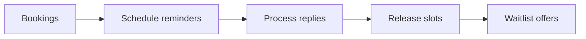

# Appointment Reminder System

> Reminders at 48 hours and 2 hours, one-tap confirm or reschedule, and freed slots offered to the waitlist.

     

**Sector:** Healthcare & Services  ·  **Project 30 of 50** in my [AI Automation Projects series](https://github.com/Princewill106/Princewill106)

## The problem

A missed appointment is an empty chair the business still pays for. Most no-shows aren't rude; people simply forget. And when someone does cancel, the slot usually stays empty because nobody tells the waitlist.

## How it works



1. **Load** — Read bookings and the waitlist (`sample_bookings.json`).
2. **Remind** — Reminders are generated for 48h and 2h before each appointment.
3. **Reply** — Replies are parsed: 1/yes confirms, 2 asks for a reschedule link, 3/cancel frees the slot.
4. **Backfill** — Freed slots are offered to the first matching person on the waitlist for that service.
5. **Risk** — Bookings with no confirmation by 24h before are flagged as no-show risks for a phone call.

## Features

- Two-stage reminders
- Reply parsing (numbers, yes/no, free text)
- Automatic waitlist backfill
- No-show risk list
- Works for clinics, salons, tutors and consultants

## Quick start

```bash
git clone https://github.com/Princewill106/appointment-reminder-system.git
cd appointment-reminder-system
python main.py --demo
```

No installs needed: it uses only the Python standard library. The demo runs fully offline using the sample data in this repo.

**Optional: plug in an LLM.** Copy `.env.example` to `.env` and add an Anthropic or OpenAI key. The project will then use the model for the language-heavy steps and fall back to its rule-based logic if a call fails.

Run the tests:

```bash
python -m unittest -v
```

## Sample output

```text
Booking statuses:
  B1 Mrs Okafor     Dental cleaning  2026-10-12T10:00  confirm
  B2 Mr Adamu       Eye test         2026-10-12T15:00  no reply
  B3 Ms Eze         Dental cleaning  2026-10-13T09:00  cancel
  B4 Mr Bassey      Physiotherapy    2026-10-14T08:30  reschedule
  B5 Mrs Lawal      Eye test         2026-10-12T17:00  unclear

Reminders due (4):
  2026-10-10T10:00 -> +2348030000101: Hi Mrs Okafor, reminder: Dental cleaning on Mon 12 Oct at 10:00. Reply 1 to confirm, 2 to reschedule, 3 to cancel.
  2026-10-12T08:00 -> +2348030000101: Hi Mrs Okafor, reminder: Dental cleaning on Mon 12 Oct at 10:00. Reply 1 to confirm, 2 to reschedule, 3 to cancel.
  2026-10-10T15:00 -> +2348030000102: Hi Mr Adamu, reminder: Eye test on Mon 12 Oct at 15:00. Reply 1 to confirm, 2 to reschedule, 3 to cancel.
  2026-10-10T17:00 -> +2348030000105: Hi Mrs Lawal, reminder: Eye test on Mon 12 Oct at 17:00. Reply 1 to confirm, 2 to reschedule, 3 to cancel.

Waitlist offers:
  Kunle: Hi Kunle, a Dental cleaning slot opened on Tue 13 Oct at 09:00. Reply YES to take it.

No-show risks:
  B2 Mr Adamu (Eye test at 15:00) has not confirmed: call them
  B5 Mrs Lawal (Eye test at 17:00) has not confirmed: call them
```

## Use it in n8n (no code needed)

[`n8n-workflow.json`](n8n-workflow.json) is a ready-to-import n8n version of this project, built for n8n 1.x.

1. In n8n, open **Workflows → Import from File** and choose `n8n-workflow.json`.
2. Click **Test workflow**. It runs the full logic on the sample data built into the *Sample data* node, so you can see the results before connecting anything.
3. Open each output node and connect your accounts: Google Sheets (OAuth2), Slack, WhatsApp Business Cloud API. For Google Sheets, pick your spreadsheet and sheet.
4. Adjust the settings at the top of the **Logic** node (thresholds, templates, contacts), then **Activate**.

**Flow:** **Schedule (hourly)** → Read bookings → **Logic** (Code node) → **Route** (Switch)

**Outputs:**
- Send WhatsApp message
- Ask front desk to call

The Logic node is a JavaScript port of the rules in `main.py`, so you can run the project in n8n without Python.

## Use it on your own data

Put bookings, waitlist and replies in the shape of `sample_bookings.json` and run `python main.py --now 2026-10-12T08:00`. Connect the outbox to SMS or WhatsApp to go live.

## Project structure

```text
n8n-workflow.json            Importable n8n workflow
.env.example                 Optional API key settings
.gitignore                   Git ignore rules
LICENSE                      MIT license
README.md                    This file
llm.py                       Optional LLM helper (offline fallback)
main.py                      Entry point and core logic
requirements.txt             Dependencies (stdlib only)
sample_bookings.json         Sample input data for the demo
test_main.py                 Unit tests
```

## Who this is for

- Clinics and dental practices
- Salons and spas
- Tutors, consultants and coaches

## Ideas to extend it

- [ ] Termii/Twilio SMS sending
- [ ] WhatsApp interactive buttons
- [ ] Google Calendar sync
- [ ] No-show prediction from history

## About

Built by **Ogbu Ugochukwu Princewill**, AI Automation Lead and robotics engineer. I teach people and businesses to build with AI, not just talk about it. [LinkedIn](https://www.linkedin.com/in/ugochukwu-ogbu-653a0816a)

If this helped you, give it a ⭐ and share what you built with it.

## License

MIT — see [LICENSE](LICENSE).
